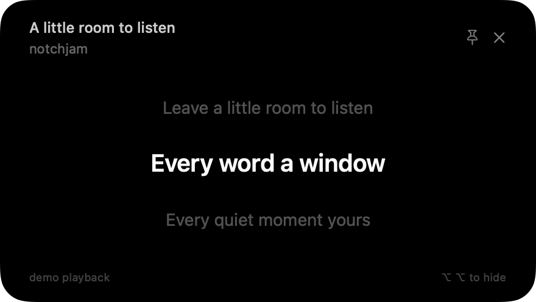

# notchjam

**get lost in the lyrics, not your workflow.**

A small native macOS menu-bar app. Double-tap **left Option** to peek at Spotify’s synchronized lyrics, then return to what you were doing. The black panel appears below the notch, or at the top center of a display without one. It never takes keyboard focus.



## Build and install

Requires **macOS 14 or later** and **Xcode 16 or later** with Swift 6. Apple Silicon is the primary target. There are no external packages, API keys, OAuth setup, or generated dependencies.

1. Open `notchjam.xcodeproj` and select the **notchjam** scheme and **My Mac**.
2. In Signing & Capabilities, select your development team, or use **Sign to Run Locally** for local testing.
3. Run with **⌘R**. The waveform icon appears in the menu bar; no persistent Dock icon is shown.
4. Open **Settings → Connect Spotify** and allow the macOS Automation prompt. Spotify must be installed and running; notchjam never intentionally launches it.
5. Enable Input Monitoring if you want double-left-Option, or use **⌘⌥L** immediately.

Command-line local build:

```sh
xcodebuild -project notchjam.xcodeproj -scheme notchjam \
  -configuration Release -derivedDataPath build CODE_SIGN_IDENTITY=- build
open build/Build/Products/Release/notchjam.app
```

Copy the built `notchjam.app` to `/Applications` for everyday use. Keep a stable installation location and signing identity so macOS can retain permission decisions. Enable **Launch at login** from Settings after installation. macOS may require approval in General → Login Items.

For distribution to other people, archive using your own Developer ID, enable hardened runtime with the supplied Apple Events entitlement, then notarize and staple the app. The repository’s local ad-hoc build is not a notarized release. The project intentionally runs outside App Sandbox for global input monitoring and local Spotify automation.

## Use

- **Double-tap left Option**: show/hide lyrics. Each tap may be held up to 350 ms, with up to 400 ms between taps.
- **⌥⌘L**: the default conventional shortcut. In Settings → Shortcut, click the shortcut recorder and press a new combination. Use Command, Option, or Control with a key, or an F-key. Escape cancels. Conflicts are reported without replacing your saved shortcut. Double-left-Option can remain enabled alongside it.
- **Stay open until toggled off** is enabled by default: either shortcut opens the panel and the next press closes it. Disable this in Settings → Lyrics panel for timed **Quick Peek** (7 seconds, adjustable to 3–30 seconds).
- **Pin** in the panel or menu: keep the panel visible. Unpin restarts the Quick Peek timer only when toggle mode is disabled. Hiding also clears the pin.
- **Settings**: animations, header, lyric size, shortcut, dismissal time, launch at login, and demo controls.
- The display under the pointer is selected when opening. A notched screen uses its safe-area geometry; a non-notched display places the capsule below the menu bar. The panel follows Spaces and supports full-screen applications as an auxiliary window.
- Previous and upcoming lyrics are dimmed. Blank timestamps display a musical break. Paused playback shows a small pause mark.
- Plain lyrics are labeled **Unsynchronized lyrics** and can be scrolled without changing keyboard focus.

The modifier detector is passive. It distinguishes the left Option hardware flag, cancels on other keys/modifiers/mouse clicks/scrolls, rejects long holds, and waits until the second release before toggling. It never suppresses ordinary Option input.

## Permissions and privacy

**Automation → Spotify:** requested only after Connect Spotify. If denied, allow notchjam in System Settings → Privacy & Security → Automation, then reconnect. There are no repeat permission prompts in the background.

**Input Monitoring:** needed only for double-left-Option. Settings shows whether it is active. Choose **Allow…**, approve notchjam in System Settings, and it turns on automatically. Ad-hoc signed builds get a new signature on every rebuild, which silently voids an earlier approval even though System Settings still shows it enabled. Use **Reset** (and **Restart notchjam** if needed) in Settings to fix that. Secure Input and some remote desktop sessions can suppress global events. The menu bar and conventional shortcut provide alternatives. Accessibility permission is not separately requested.

There are no analytics. Only song title, artist, album, and duration are sent over HTTPS to [LRCLIB](https://lrclib.net/docs) for lookup. Input event text is never read, stored, or transmitted. Spotify credentials are never accessed. Lyrics are cached locally, not uploaded.

Preferences use `UserDefaults` under `com.notchjam.app`. The disposable lyric cache is in `~/Library/Caches/com.notchjam.app/lyrics`, capped at 500 entries. Positive results expire after 30 days; missing results after 6 hours. Network failures are never cached as missing lyrics. You can remove that cache directory while notchjam is closed.

## Demo and tests

To test without Spotify, enable **Use demo playback** in Settings, then choose Peek. Demo controls pause/resume and seek by 10 seconds. The 48-second loop contains original sample lyrics in `Core/MockPlayback.swift`; no copyrighted song text is bundled. Demo mode is session-only and makes no Spotify or lyric API requests.

```sh
open -n build/Build/Products/Release/notchjam.app --args --mock
swift test
xcodebuild -project notchjam.xcodeproj -scheme notchjam \
  -destination 'platform=macOS' -derivedDataPath build CODE_SIGN_IDENTITY=- test
```

The same Swift Testing suite runs both as a dependency-free Swift package and in the Xcode test target. It covers timestamp formats, offsets, duplicate lines/translations, Unicode, musical breaks, lyric boundaries, seeking, pause/resume clock behavior, recording matching, shortcut timing/chord rejection, exact/fallback/plain/instrumental/missing API responses, persistent offline caching, cancellation, and rate limits. API tests use deterministic `URLProtocol` fixtures and never contact LRCLIB.

Render the actual view offscreen:

```sh
python3 scripts/render-preview.py
# Output: build/qa/panel.png
```

See [verification notes and desktop acceptance checklist](docs/TESTING.md) for the checks actually run and platform restrictions.

## Architecture

| Component | Responsibility |
| --- | --- |
| `App/NotchjamApp.swift` | Accessory application lifecycle, menu bar, preferences window, sleep/wake and screen events |
| `App/Preferences.swift` | Observable persisted preferences |
| `Services/SpotifyService.swift` | Serialized, off-main AppleScript reads with a 3-second Apple Event timeout |
| `Core/LyricsService.swift` | LRCLIB URLSession requests, fallback search, throttling, Retry-After handling, bounded disk cache |
| `Core/LyricsParser.swift` | LRC normalization, offsets, repeated timestamps and musical breaks |
| `Core/TrackMatcher.swift` | Conservative title/artist/duration matching and album-aware ranking |
| `App/PlaybackCoordinator.swift` | Playback clock, polling, cancellation/generation checks, lyric state, demo controls |
| `Services/HotkeyManager.swift` | Listen-only CGEvent tap and registered Carbon fallback hotkey |
| `Core/OptionTapRecognizer.swift` | Independently testable double-tap state machine |
| `UI/NotchPanelController.swift` | Nonactivating NSPanel, screen placement, presentation and dismissal lifecycle |
| `UI/LyricsView.swift` | Compact SwiftUI lyrics and empty/error/loading states |
| `UI/SettingsView.swift` | Preferences and explicit permission setup |

Spotify is sampled every 0.75 seconds while visible, every 2 seconds while hidden and playing, and every 4 seconds while idle. A monotonic local clock interpolates position between samples; seeking is corrected on the next sample. The 10 Hz lyric ticker only runs while the panel is visible. Sleep cancels polling and lyric work; wake starts with fresh state. Song changes debounce lyric lookups by 200 ms, cancel old requests, and guard every result against a generation token.

Requests follow LRCLIB’s documented `/api/get` then `/api/search` flow, with a client-identifying User-Agent, sequential requests, a 300 ms minimum interval, and Retry-After backoff. Transient failures retry while visible after 30 seconds (or the service’s deadline), and have an explicit Try again control. Track matching intentionally rejects alternate live/remix recordings and durations more than five seconds apart rather than showing misleading synchronization.

`Package.swift` exposes only the testable core. The Xcode project builds the complete app and native test bundle. If adding source files, rerun `python3 scripts/generate-project.py`; no project generator dependency is required.

## Known limitations and future improvements

- LRCLIB is community-maintained; coverage and timing vary. Conservative matching can miss collaborations or unusually named releases. Manual result selection and timing adjustment would be useful additions.
- Seeking/track changes are observed on the next Spotify poll, not sample-accurately. Podcasts, ads, and recordings absent from LRCLIB generally have no lyrics.
- Permission approval, Secure Input, other applications’ hotkey registrations, and macOS full-screen behavior can affect global shortcuts/overlay visibility. The menu-bar controls remain the reliable fallback.
- Global keyboard permission, live Spotify playback, sleep/wake, and real multi-display behavior still require the desktop acceptance pass described in `docs/TESTING.md`.
- Developer ID signing/notarization and distribution packaging require the distributor’s Apple account. A future release could add localization, additional shortcut presets, and manual lyric corrections.
